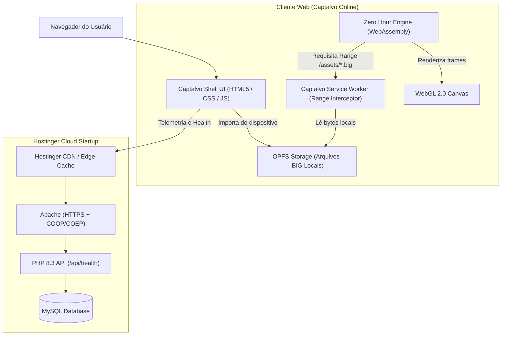

# CAPTALVO — Arquitetura de Sistema

## 1. Visão Geral

O **Captalvo** é uma plataforma de simulação de estratégia militar em tempo real executada nativamente em navegadores modernos, construída com base no motor clássico do *Command & Conquer: Generals Zero Hour*.

A arquitetura foi projetada para garantir:
1. **Total conformidade legal:** Não distribui arquivos comerciais da EA no servidor.
2. **Execução rápida no cliente:** Motor C++ moderno compilado via WebAssembly (WASM) com renderização WebGL 2.0.
3. **Isolamento de dados e streaming:** Uso de OPFS (Origin Private File System) com Service Worker para fornecer fatias de arquivos `.big` via HTTP Range requests de forma 100% local no navegador.
4. **Backend seguro e desacoplado:** PHP 8.3 + MySQL fornecendo APIs de telemetria, autenticação e no futuro estado persistente de mundo.

---

## 2. Diagrama de Arquitetura

---

## 3. Segurança e Armazenamento dos Dados do Jogo

- O usuário seleciona a pasta da sua instalação local (`D:\Command and Conquer Generals Zero Hour`).
- O navegador utiliza a `File System Access API` (`showDirectoryPicker`) para ler os arquivos `.big` necessários.
- Os arquivos são salvos diretamente no **Origin Private File System (OPFS)** do navegador do usuário.
- O **Service Worker** do Captalvo intercepta requisições `GET /assets/*.big` que contenham o cabeçalho `Range: bytes=start-end`, lê a fatia correspondente diretamente do arquivo salvo no OPFS e devolve HTTP `206 Partial Content`.
- **Zero tráfego de rede** contendo mídia proprietária é enviado para o servidor Hostinger.
